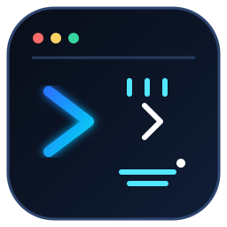
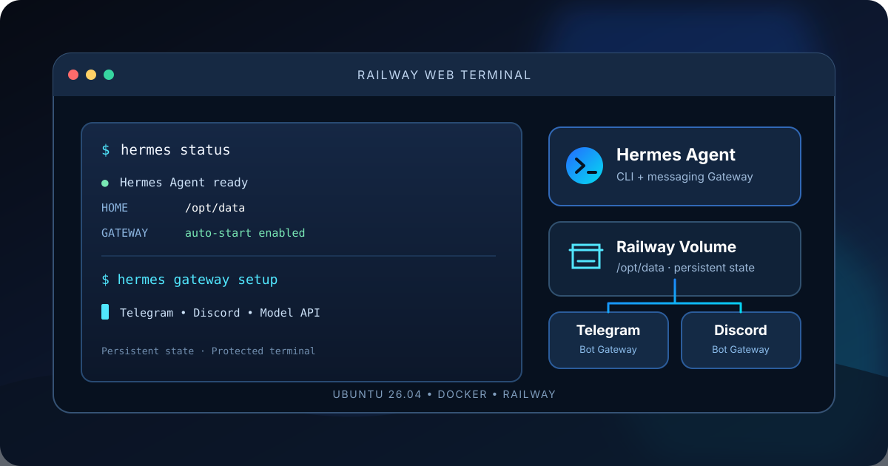
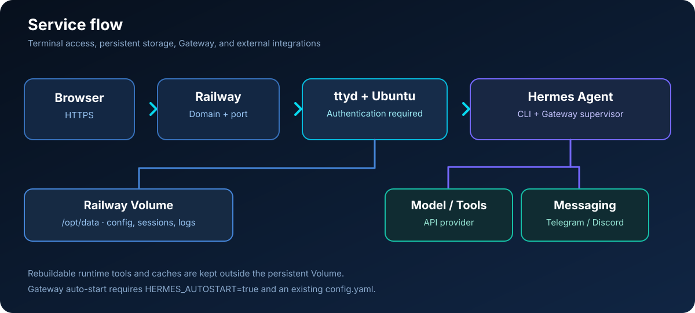

# Ubuntu Hermes Railway

  
  
  
  
  
  

<a href="README.md">🇮🇩 Bahasa Indonesia</a> · <a href="README.en.md">🇬🇧 English</a>

<strong>Ubuntu terminal on Railway with Hermes Agent CLI and chat Gateway.</strong> 
Open a browser terminal, keep Hermes configuration in a Railway Volume, and connect Hermes to Telegram and/or Discord.

  <a href="#quick-start">Quick start</a> ·
  <a href="#features">Features</a> ·
  <a href="#architecture-overview">Architecture</a> ·
  <a href="#deployment-guide">Deployment guide</a> ·
  <a href="#troubleshooting">Troubleshooting</a> ·
  <a href="#privacy-and-security">Privacy &amp; security</a> ·
  <a href="#development">Development</a> ·
  <a href="#sources-attribution-and-license">Sources &amp; license</a> ·
  <a href="#contributing">Contributing</a> ·
  <a href="#project-security">Security</a>

---

Original documentation illustration — not an official Ubuntu, Hermes Agent, or Railway screenshot.

> [!WARNING]
> **This service exposes a Linux shell through a web domain.** Use a unique, strong password and a trusted access gateway where possible. The shell runs as root inside the container. Password authentication alone should not be treated as additional access control for sensitive services.

## Quick start

1. In Railway, create a project from [ubuntu-hermes-railway](https://github.com/DURIAN-ORGANISASI/ubuntu-hermes-railway), using the Dockerfile at the repository root.
2. Set the terminal variables and mount a Railway Volume at **/opt/data** before the first Hermes setup.
3. Deploy and generate a domain under **Settings → Networking**. Sign in using the username and password you configured.
4. In the browser terminal, run the following commands in order:

   ~~~bash
   hermes setup
   hermes gateway setup
   ~~~

5. After setup, restart the Railway service and test Telegram or Discord. See the [deployment guide](#deployment-guide) for details.

## Features

- **Ubuntu 26.04** base image for Hermes Agent CLI.
- **Browser terminal** powered by ttyd with username/password authentication and Origin checking.
- **Hermes installed during Docker build**, including Telegram and Discord messaging dependencies.
- **Gateway auto-start** after Hermes configuration exists, with a restart loop if the Gateway exits.
- **Separated storage:** configuration, sessions, memory, and logs stay in /opt/data; rebuildable tools and caches are redirected outside the Volume.
- **Interactive shell** with Git, Python, pip/venv, curl, compilers, and system utilities.
- **System banner** with OS, architecture, uptime, CPU, memory, disk, timezone, and Gateway status.
- **AMD64 and ARM64** support for the supplied ttyd binaries.
- **GitHub Actions checks** shell syntax, builds the Docker image, tests authenticated access, and verifies that unauthenticated requests are rejected.

The installer runs at build time in non-interactive mode without the browser component. No production API keys, bot tokens, or passwords are stored in this repository.

## Architecture overview

1. A browser connects to the Railway domain over HTTPS.
2. ttyd requires username/password authentication and opens a shell inside the Ubuntu container.
3. Hermes CLI stores configuration and user data in /opt/data, mounted as a Railway Volume.
4. Hermes Gateway runs as a container process when auto-start is enabled and configuration is present.
5. The Gateway communicates with the selected model provider and messaging platform using the credentials you configured.

| Path | Purpose | Persistent? |
| --- | --- | --- |
| /opt/data | Hermes configuration, sessions, memory, and logs | Yes, if a Railway Volume is mounted here |
| /data | Terminal working directory | Not by default; add a separate Volume if needed |
| /usr/local/share/hermes-tools | Rebuildable runtime tools and cache | No; on the container filesystem |
| /tmp/uv-cache | Temporary cache | No |

## Deployment guide

### 1. Create a Railway service

1. Select **New Project → Deploy from GitHub Repo** and choose this repository.
2. Keep the Dockerfile at the repository root. Leave Start Command empty because the image already defines an ENTRYPOINT.
3. Under **Settings → Networking**, generate a domain.
4. Create a Railway Volume and mount it at **/opt/data** before running Hermes setup.
5. Add the variables below, then deploy.

### 2. Railway variables

Copy these to **Railway → service → Variables** and replace the placeholders.

~~~dotenv
TERMINAL_USER=REPLACE_WITH_UNIQUE_USERNAME
TERMINAL_PASSWORD=REPLACE_WITH_RANDOM_PASSWORD_AT_LEAST_24_CHARACTERS
TZ=Asia/Jakarta
HERMES_HOME=/opt/data
HERMES_RUNTIME_DIR=/usr/local/share/hermes-tools
UV_CACHE_DIR=/tmp/uv-cache
HERMES_AUTOSTART=true
~~~

Important:

- TERMINAL_USER is required and must not contain a colon (:).
- TERMINAL_PASSWORD is required and must be at least 16 characters; use a unique random password, preferably 24 characters or longer.
- Keep HERMES_HOME=/opt/data when the Volume is mounted there.
- HERMES_RUNTIME_DIR must remain outside /opt/data to keep rebuildable tools off the limited persistent Volume.
- HERMES_AUTOSTART=true starts the Gateway after its configuration exists. Set it to false only for diagnosis or deliberate manual Gateway operation.
- Do not set PORT manually. Railway injects PORT; the image uses 8080 as a fallback.
- Never add placeholder API keys or bot tokens to Railway Variables. Configure real credentials through the wizard, or intentionally use environment variables with valid values.

### 3. Sign in and verify the terminal

After deployment, open the Railway domain and log in. If it does not load, inspect Deploy Logs and verify the service's networking port.

Run:

~~~bash
command -v hermes
hermes --version
~~~

If both commands return the executable location and version, continue setup.

### 4. Configure Hermes

With the Volume mounted at /opt/data, run:

~~~bash
hermes setup
~~~

Wizard labels and option numbers may change by version. Select by the displayed name or purpose, not by number alone.

| Prompt | Suggested choice | Notes |
| --- | --- | --- |
| Model/provider | Choose a provider for which you have a valid key or login | Model providers differ from web-search and TTS providers |
| Terminal backend | **Keep current (local)** | Uses the current container; Docker-in-Docker is not required for normal Hermes usage |
| Image generation | **Skip / configure later** if not needed | Optional feature |
| Text-to-speech | **Microsoft Edge TTS / Edge TTS**, if available | Does not require a separate API key |
| Web search | Choose an available provider and enter a real key if required | Never enter a placeholder such as YOUR_API_KEY |
| Shared metrics / telemetry | **No thanks**, if you prefer not to enable shared metrics | Follow the options shown by your installed version |

Complete the wizard until **Setup Complete** appears and you return to the shell. Warnings for providers you do not use do not necessarily mean your active provider has failed.

Check status:

~~~bash
hermes doctor
hermes status
~~~

### 5. Configure and start the Gateway

Configure your messaging platform:

~~~bash
hermes gateway setup
~~~

Choose Telegram and/or Discord, enter the correct bot token, and configure permitted users. Then run:

~~~bash
hermes doctor
hermes gateway status
hermes status
~~~

With HERMES_AUTOSTART=true, the entrypoint starts the Gateway once /opt/data/config.yaml exists. Since setup may occur while the container is already running, **restart/redeploy the Railway service after setup**. Do not start a second Gateway with the same bot token.

If auto-start is deliberately disabled with HERMES_AUTOSTART=false, start-hermes runs the Gateway in the foreground. Do not use an interactive terminal session as a permanent substitute for a Gateway managed by the container.

### 6. Connect Telegram

1. Open Telegram and message @BotFather.
2. Send /newbot if you do not already have a bot, then keep its token secret.
3. Run hermes gateway setup in the Railway terminal and select Telegram.
4. Enter the token and complete user authorization or pairing prompts.
5. If pairing is required, check the request sent by the bot and approve it in the terminal with the actual code:

   ~~~bash
   hermes pairing list
   hermes pairing approve telegram ACTUAL_PAIRING_CODE
   ~~~

   Replace ACTUAL_PAIRING_CODE with the real code; do not copy the placeholder literally.
6. Restart the Railway service, send /start, and test with a normal message.

Do not run two Gateways with the same Telegram token because polling can conflict.

### 7. Connect Discord

1. Create an application in the [Discord Developer Portal](https://discord.com/developers/applications), open its **Bot** tab, and keep the bot token private.
2. Enable **Message Content Intent** under Bot → Privileged Gateway Intents. Enable Server Members Intent only if your access policy needs it or the error message requests it.
3. Under OAuth2 → URL Generator, select bot and applications.commands scopes. Grant only the required permissions, including View Channels, Send Messages, and Read Message History for the test channel.
4. Invite the bot to the correct server.
5. Enable Developer Mode in Discord and copy your numeric User ID.
6. Run hermes gateway setup, choose Discord, enter the bot token, and complete allowlist or pairing setup.
7. Test in a DM first. In server channels, Hermes generally needs to be mentioned unless configured otherwise.

The bot token authenticates the application; the allowlist controls which users can interact. An online bot may still lack permission to read specific channels.

### 8. Streaming and slow responses

Streaming changes how text is displayed but does not guarantee a faster first token from the model/provider. To inspect Telegram streaming configuration:

~~~bash
hermes config set streaming.enabled true
hermes config set display.platforms.telegram.streaming true
hermes config get streaming.enabled
hermes config get display.platforms.telegram.streaming
hermes config get display.platforms.discord.streaming
~~~

Restart the Railway service after changing Gateway configuration.

Test the model from the terminal with a single request:

~~~bash
hermes -c "Reply only: OK"
~~~

If the CLI is also slow, the issue may relate to the provider, model, reasoning, or network. If CLI replies quickly but chat responses lag, inspect Gateway status and Railway deployment logs.

## Troubleshooting

| Problem | What to check |
| --- | --- |
| Domain does not load | Service status, Settings → Networking, PORT, and Deploy Logs |
| Terminal login fails | TERMINAL_USER and TERMINAL_PASSWORD; password must be at least 16 characters and username must not contain a colon |
| Service exits on startup | Environment validation, permissions, and entrypoint errors in logs |
| Setup disappears after redeploy | Confirm the Railway Volume is mounted at /opt/data before setup |
| Hermes command not found | Check the latest build, Build Logs, then run command -v hermes |
| Configuration file is missing | Finish hermes setup and keep HERMES_HOME=/opt/data |
| Gateway stopped after setup | Confirm HERMES_AUTOSTART=true and config exists, then restart the service once |
| Telegram does not respond | Check token, user authorization/pairing, Gateway status, and duplicate Gateways |
| Discord is online but silent | Check Message Content Intent, allowlist, channel permissions, then test DM or mention |
| User not allowed / no access policy | Repeat hermes gateway setup and ensure the numeric user ID is allowed |
| PrivilegedIntentsRequired | Check Privileged Gateway Intents in Discord Developer Portal |
| Slow model / first_chunk timeout | Run hermes -c "Reply only: OK", verify provider/model, then inspect Gateway status and logs |
| Unused provider warns about login | Confirm the active provider in hermes status; unused providers can still show warnings |
| Terminal rejects password | Check Railway Variables, password length, and startup logs |

Useful diagnostic commands:

~~~bash
hermes status
hermes gateway status
hermes doctor
~~~

## Privacy and security

- **Public terminal:** Railway domains are reachable from the internet. Password login helps, but is not a replacement for a trusted access gateway for sensitive systems.
- **Privileges:** the shell runs as root inside the container. Be careful with commands that modify or delete files.
- **Credentials:** never commit API keys, Telegram/Discord tokens, or terminal passwords to GitHub, README files, screenshots, or public logs. Rotate any leaked credential.
- **Allowlist:** permit only trusted users, especially when Hermes has tools that can read files or execute commands.
- **Persistence:** only paths mounted as Railway Volumes persist according to the Volume configuration. /data is not persistent by default.
- **Single Gateway per token:** do not run multiple active Gateways using the same bot token.
- **Usage costs:** model and tool use are subject to each provider's quotas, fees, and terms.

## Development

Clone the repository, check shell syntax, and build the image:

~~~bash
git clone https://github.com/DURIAN-ORGANISASI/ubuntu-hermes-railway.git
cd ubuntu-hermes-railway
bash -n entrypoint.sh
bash -n start-hermes
bash -n system-banner.sh
docker build --tag ubuntu-hermes-railway .
~~~

GitHub Actions checks shell syntax, builds the image, then verifies that authenticated terminal access returns HTTP 200 and unauthenticated requests are rejected. It does not test model-provider APIs, Telegram/Discord integrations, or a live Railway deployment.

## Sources, attribution, and license

See [docs/SOURCES.md](docs/SOURCES.md) for upstream documentation, original SVG assets, and license scope.

- **This repository:** [MIT License](LICENSE) covers project materials within its scope, including wrapper scripts, configuration, and documentation created here.
- **Hermes Agent:** upstream software and dependencies have their own licenses and terms. The repository's MIT license does not automatically relicense every component.
- **Ubuntu, ttyd, Docker, Railway, Telegram, and Discord:** their names, brands, products, and services belong to their respective owners and remain subject to their terms.
- Review upstream licenses and documentation before redistributing images or enabling optional capabilities.

## Contributing

Issues and Pull Requests are welcome. Read [CONTRIBUTING.md](CONTRIBUTING.md) for checks to run before proposing a change. Do not upload passwords, API keys, bot tokens, private configuration files, or logs containing secrets.

## Project security

To report a potential vulnerability, follow [SECURITY.md](SECURITY.md). Avoid publicly disclosing tokens, passwords, private terminal URLs, or deployment details that could expose the service.

---

  Ubuntu Hermes Railway — persistent terminal access for Hermes Agent on Railway.

