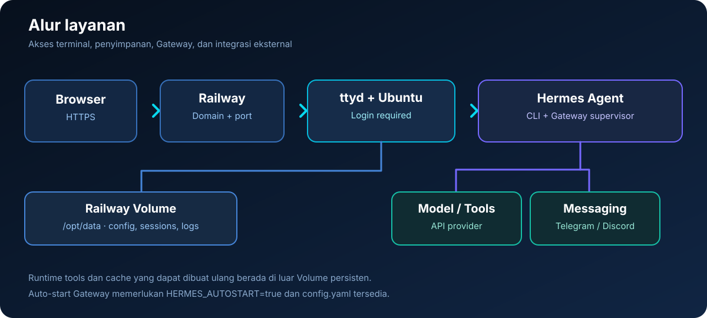

   &nbsp;&nbsp;

# Ubuntu Hermes Railway

  
  
  
  
  
  

<a href="README.md">🇮🇩 Bahasa Indonesia</a> · <a href="README.en.md">🇬🇧 English</a>

<strong>Terminal Ubuntu di Railway, lengkap dengan Hermes Agent CLI dan Gateway chat.</strong> 
Akses terminal lewat browser, simpan konfigurasi di Railway Volume, lalu hubungkan Hermes ke Telegram dan/atau Discord.

  <a href="#coba-sekarang">Mulai cepat</a> ·
  <a href="#fitur">Fitur</a> ·
  <a href="#arsitektur-singkat">Arsitektur</a> ·
  <a href="#cara-pakai">Panduan penggunaan</a> ·
  <a href="#troubleshooting">Troubleshooting</a> ·
  <a href="#privasi-dan-keamanan">Privasi &amp; keamanan</a> ·
  <a href="#pengembangan">Pengembangan</a> ·
  <a href="#sumber-atribusi-dan-lisensi">Sumber &amp; lisensi</a> ·
  <a href="#kontribusi">Kontribusi</a> ·
  <a href="#keamanan-proyek">Keamanan</a>

---

Ilustrasi orisinal untuk dokumentasi — bukan screenshot resmi Ubuntu, Hermes Agent, atau Railway.

> [!WARNING]
> **Terminal ini memberi akses shell Linux melalui domain web.** Gunakan password unik yang kuat, jangan commit kredensial, dan batasi akses publik dengan access gateway tepercaya bila memungkinkan. Shell berjalan sebagai root di dalam container. Autentikasi password bukan pengganti pembatasan akses tambahan untuk layanan sensitif.

## Coba sekarang

1. Di Railway, buat project dari repository [ubuntu-hermes-railway](https://github.com/DURIAN-ORGANISASI/ubuntu-hermes-railway). Gunakan Dockerfile di root repository.
2. Tambahkan variabel terminal, lalu pasang Railway Volume dengan mount path tepat **/opt/data** sebelum setup Hermes pertama kali.
3. Deploy dan buat domain pada **Settings → Networking**. Login memakai username dan password yang kamu atur.
4. Dari terminal browser, jalankan perintah berikut secara berurutan:

   ~~~bash
   hermes setup
   hermes gateway setup
   ~~~

5. Setelah konfigurasi selesai, restart service Railway dan uji bot dari Telegram atau Discord. Lihat [panduan lengkap](#cara-pakai) jika ini instalasi pertama.

## Fitur

- **Ubuntu 26.04** sebagai image dasar untuk menjalankan Hermes Agent CLI.
- **Terminal web ttyd** dengan autentikasi username/password dan pemeriksaan Origin.
- **Hermes dipasang saat Docker build**, termasuk dependency messaging Telegram dan Discord.
- **Gateway auto-start** setelah konfigurasi Hermes tersedia, dengan loop restart bila Gateway keluar.
- **Penyimpanan terpisah:** konfigurasi, sesi, memori, dan log Hermes berada di /opt/data; cache dan runtime tools yang dapat dibuat ulang dipindahkan ke luar Volume.
- **Terminal interaktif** untuk Hermes CLI, Git, Python, pip/venv, curl, compiler, dan utilitas sistem.
- **Banner sistem** yang menampilkan informasi OS, arsitektur, uptime, CPU, RAM, disk, zona waktu, dan status Gateway.
- **Kompatibilitas AMD64 dan ARM64** untuk binary ttyd yang disediakan.
- **Validasi GitHub Actions** untuk sintaks shell, build Docker, autentikasi terminal, dan penolakan request tanpa autentikasi.

Installer Hermes dijalankan saat build dengan opsi non-interaktif dan tanpa browser. Repository ini tidak menyimpan API key, token bot, atau password produksi.

## Arsitektur singkat

1. Browser terhubung ke domain Railway melalui HTTPS.
2. ttyd meminta autentikasi username/password dan membuka shell di container Ubuntu.
3. Hermes CLI menyimpan konfigurasi dan data pengguna di /opt/data yang dipasang sebagai Railway Volume.
4. Hermes Gateway berjalan sebagai proses container ketika auto-start aktif dan konfigurasi sudah tersedia.
5. Gateway berkomunikasi dengan provider model dan platform pesan sesuai credential yang kamu konfigurasi.

**Direktori penting**

| Path | Fungsi | Persisten? |
| --- | --- | --- |
| /opt/data | Konfigurasi Hermes, sesi, memori, dan log | Ya, jika Railway Volume dipasang ke path ini |
| /data | Direktori kerja terminal | Tidak dijamin, kecuali dipasangi Volume tambahan |
| /usr/local/share/hermes-tools | Runtime tools dan cache yang dapat dibuat ulang | Tidak; berada di filesystem container |
| /tmp/uv-cache | Cache sementara | Tidak |

## Cara pakai

### 1. Buat service di Railway

1. Buka Railway dan pilih **New Project → Deploy from GitHub Repo**.
2. Pilih repository ini dan pastikan build memakai Dockerfile di root. Biarkan Start Command kosong karena image sudah memiliki ENTRYPOINT.
3. Pada **Settings → Networking**, buat domain untuk terminal.
4. Buat Railway Volume dan pasang mount path **/opt/data** sebelum menjalankan setup Hermes.
5. Buka **Variables** dan isi konfigurasi berikut, kemudian deploy.

### 2. Railway Variables

Salin blok ini ke **Railway → service → Variables**. Ganti placeholder dengan kredensial milikmu.

~~~dotenv
TERMINAL_USER=GANTI_DENGAN_USERNAME_UNIK
TERMINAL_PASSWORD=GANTI_PASSWORD_ACAK_MINIMAL_24_KARAKTER
TZ=Asia/Jakarta
HERMES_HOME=/opt/data
HERMES_RUNTIME_DIR=/usr/local/share/hermes-tools
UV_CACHE_DIR=/tmp/uv-cache
HERMES_AUTOSTART=true
~~~

Ketentuan penting:

- TERMINAL_USER wajib diisi dan tidak boleh mengandung titik dua (:).
- TERMINAL_PASSWORD wajib minimal 16 karakter; gunakan password acak unik, disarankan 24 karakter atau lebih.
- Pertahankan HERMES_HOME=/opt/data jika Volume dipasang di /opt/data.
- HERMES_RUNTIME_DIR harus berada di luar /opt/data supaya runtime tools tidak memenuhi Volume yang ukurannya terbatas.
- HERMES_AUTOSTART=true memungkinkan Gateway dimulai otomatis setelah file konfigurasi tersedia. Gunakan false hanya untuk diagnosis atau bila sengaja mengelola Gateway secara manual.
- Jangan menambahkan PORT sendiri. Railway menyuntikkan PORT; image memakai 8080 sebagai nilai fallback.
- Jangan mengisi API key atau token dengan placeholder. Masukkan credential nyata melalui wizard atau melalui Railway Variables hanya jika memang sengaja memakai cara tersebut.

### 3. Login dan periksa terminal

Setelah deployment selesai, buka domain Railway dan login. Jika terminal tidak terbuka, periksa Deploy Logs dan pastikan domain mengarah ke port service yang benar.

Jalankan:

~~~bash
command -v hermes
hermes --version
~~~

Jika kedua perintah menampilkan lokasi dan versi Hermes, lanjutkan setup.

### 4. Setup Hermes

Pastikan Volume di /opt/data sudah terpasang, kemudian jalankan:

~~~bash
hermes setup
~~~

Nama dan urutan opsi wizard dapat berubah antarversi. Pilih berdasarkan nama atau fungsi, bukan hanya nomor pilihan.

| Prompt | Saran | Catatan |
| --- | --- | --- |
| Model/provider | Pilih provider yang memang kamu miliki API key atau akses loginnya | Provider model berbeda dari provider pencarian web dan TTS |
| Terminal backend | **Keep current (local)** | Menjalankan terminal dalam container ini; tidak perlu Docker-in-Docker untuk penggunaan normal |
| Image generation | **Skip / configure later** bila belum diperlukan | Fitur opsional |
| Text-to-speech | **Microsoft Edge TTS / Edge TTS** jika tersedia | Opsi yang tidak memerlukan API key terpisah |
| Web search | Pilih provider yang tersedia dan isi key asli jika diminta | Jangan mengisi placeholder seperti YOUR_API_KEY |
| Shared metrics / telemetry | **No thanks**, jika ingin tidak mengaktifkan metrik bersama | Ikuti prompt versi Hermes yang terpasang |

Selesaikan wizard sampai muncul **Setup Complete** dan kembali ke shell. Peringatan login provider lain yang tidak kamu gunakan belum tentu berarti provider aktif gagal.

Periksa status:

~~~bash
hermes doctor
hermes status
~~~

### 5. Konfigurasikan dan mulai Gateway

Konfigurasikan platform chat:

~~~bash
hermes gateway setup
~~~

Pilih Telegram dan/atau Discord, masukkan token bot yang benar, dan atur pengguna yang diizinkan. Setelah setup selesai, periksa:

~~~bash
hermes doctor
hermes gateway status
hermes status
~~~

Dengan HERMES_AUTOSTART=true, entrypoint menjalankan Gateway setelah menemukan /opt/data/config.yaml. Karena setup dilakukan ketika container mungkin sudah berjalan, **restart/redeploy service Railway setelah wizard selesai**. Jangan menyalakan Gateway kedua secara manual dengan token yang sama.

Jika kamu sengaja menonaktifkan auto-start dengan HERMES_AUTOSTART=false, perintah start-hermes menjalankan Gateway di foreground. Jangan jadikan sesi terminal interaktif sebagai pengganti proses Gateway yang dikelola container.

### 6. Hubungkan Telegram

1. Buka Telegram dan chat @BotFather.
2. Kirim /newbot jika belum punya bot, lalu simpan token yang diberikan secara rahasia.
3. Jalankan hermes gateway setup di terminal Railway dan pilih Telegram.
4. Masukkan token bot, lalu ikuti prompt untuk mengizinkan user atau pairing.
5. Bila mendapat kode pairing, lihat permintaan yang tampil di Telegram dan setujui dari terminal menggunakan kode aktual:

   ~~~bash
   hermes pairing list
   hermes pairing approve telegram KODE_PAIRING_AKTUAL
   ~~~

   Ganti KODE_PAIRING_AKTUAL dengan kode nyata; jangan menyalin teks placeholder secara literal.
6. Restart service Railway, lalu kirim /start dan pesan uji ke bot.

Jangan menjalankan dua Gateway dengan token Telegram yang sama karena polling bisa bertabrakan.

### 7. Hubungkan Discord

1. Buat aplikasi pada [Discord Developer Portal](https://discord.com/developers/applications), lalu buat atau buka tab **Bot** dan simpan token bot.
2. Aktifkan **Message Content Intent** pada Bot → Privileged Gateway Intents. Aktifkan Server Members Intent hanya jika diperlukan oleh konfigurasi aksesmu atau error yang ditampilkan.
3. Pada OAuth2 → URL Generator, pilih scope bot dan applications.commands; berikan permission minimum yang diperlukan, termasuk View Channels, Send Messages, dan Read Message History untuk channel yang diuji.
4. Undang bot ke server yang benar.
5. Aktifkan Developer Mode di Discord lalu salin User ID numerik milikmu.
6. Jalankan hermes gateway setup, pilih Discord, masukkan token, dan selesaikan allowlist atau pairing.
7. Tes lewat DM terlebih dahulu. Di channel server, Hermes umumnya memerlukan mention bot kecuali pengaturannya menyatakan lain.

Token bot mengautentikasi aplikasi, sedangkan allowlist menentukan pengguna yang boleh berinteraksi. Bot yang sudah online belum tentu punya izin membaca setiap channel.

### 8. Pengaturan streaming dan respons lambat

Streaming mengubah cara jawaban ditampilkan, tetapi tidak menjamin model/provider memberi token pertama lebih cepat. Untuk memeriksa pengaturan Telegram:

~~~bash
hermes config set streaming.enabled true
hermes config set display.platforms.telegram.streaming true
hermes config get streaming.enabled
hermes config get display.platforms.telegram.streaming
hermes config get display.platforms.discord.streaming
~~~

Setelah perubahan konfigurasi Gateway, restart service agar Gateway memuat pengaturan terbaru.

Untuk menguji provider dari terminal dengan satu permintaan:

~~~bash
hermes -c "Balas hanya: OK"
~~~

Jika perintah CLI juga lambat, masalah mungkin berada pada provider, model, reasoning, atau jaringan. Jika CLI cepat tetapi chat bot lambat, periksa status Gateway serta log deploy Railway.

## Troubleshooting

| Masalah | Yang perlu diperiksa |
| --- | --- |
| Domain tidak terbuka | Status service, Settings → Networking, PORT, dan Deploy Logs |
| Login terminal gagal | TERMINAL_USER dan TERMINAL_PASSWORD; password minimal 16 karakter dan username tidak boleh berisi titik dua |
| Service berhenti saat startup | Periksa log validasi environment, permission, dan error entrypoint |
| Setup hilang setelah redeploy | Pastikan Railway Volume benar-benar terpasang ke /opt/data sebelum setup |
| Hermes tidak ditemukan | Periksa build terbaru, Build Logs, lalu jalankan command -v hermes |
| Config tidak ditemukan | Selesaikan hermes setup dan pastikan HERMES_HOME=/opt/data |
| Gateway stopped setelah setup | Pastikan HERMES_AUTOSTART=true, config tersedia, lalu restart service satu kali |
| Telegram tidak merespons | Periksa token, izin/pairing user, Gateway status, dan pastikan tidak ada Gateway lain dengan token sama |
| Discord online tetapi diam | Periksa Message Content Intent, user allowlist, permission channel, lalu coba DM atau mention bot |
| User not allowed / no access policy | Ulangi hermes gateway setup dan pastikan user ID numerik diizinkan |
| PrivilegedIntentsRequired | Periksa Privileged Gateway Intents di Discord Developer Portal |
| Respons model lambat / first_chunk timeout | Jalankan hermes -c "Balas hanya: OK", periksa provider/model, lalu periksa status dan log Gateway |
| Provider menunjukkan peringatan login | Pastikan provider/model aktif di hermes status; provider yang tidak dipakai bisa tetap menunjukkan peringatan |
| Terminal menolak password | Periksa panjang password, variabel Railway, dan log startup |

Untuk memeriksa status layanan dari terminal:

~~~bash
hermes status
hermes gateway status
hermes doctor
~~~

## Privasi dan keamanan

- **Terminal publik:** domain Railway dapat dijangkau dari internet. Password melindungi login, tetapi bukan pengganti access gateway tepercaya untuk sistem sensitif.
- **Hak akses:** shell berjalan sebagai root di dalam container. Berhati-hatilah menjalankan perintah yang mengubah atau menghapus file.
- **Credential:** jangan masukkan API key, token Telegram/Discord, atau password ke GitHub, README, screenshot, maupun log publik. Rotasi credential jika bocor.
- **Allowlist:** izinkan hanya user yang benar-benar kamu percayai, khususnya bila Hermes memiliki tools yang dapat membaca file atau menjalankan perintah.
- **Persistensi:** hanya data di path yang dipasang sebagai Railway Volume yang dijamin bertahan sesuai konfigurasi Volume. /data tidak persisten secara default.
- **Gateway tunggal:** jangan gunakan token bot yang sama pada beberapa Gateway aktif sekaligus.
- **Biaya dan kuota:** pemakaian model dan tools mengikuti kuota, biaya, serta ketentuan provider terkait.

## Pengembangan

Clone repository dan periksa sintaks shell:

~~~bash
git clone https://github.com/DURIAN-ORGANISASI/ubuntu-hermes-railway.git
cd ubuntu-hermes-railway
bash -n entrypoint.sh
bash -n start-hermes
bash -n system-banner.sh
docker build --tag ubuntu-hermes-railway .
~~~

GitHub Actions menjalankan pemeriksaan sintaks, membangun image, lalu menguji bahwa terminal berautentikasi mengembalikan HTTP 200 dan request tanpa autentikasi ditolak. Tes ini tidak memvalidasi API provider, Telegram/Discord, atau deployment Railway yang sedang berjalan.

### Struktur repository

~~~text
.
├── Dockerfile
├── entrypoint.sh
├── start-hermes
├── system-banner.sh
├── .env.example
├── LICENSE
├── README.md
├── README.en.md
├── CONTRIBUTING.md
├── SECURITY.md
├── docs/
│   ├── hero.id.svg
│   ├── architecture.id.svg
│   ├── architecture.en.svg
│   └── SOURCES.md
└── .github/
    └── workflows/
        └── docker-build.yml
~~~

## Sumber, atribusi, dan lisensi

Lihat [docs/SOURCES.md](docs/SOURCES.md) untuk dokumentasi upstream, catatan aset SVG, dan penjelasan cakupan lisensi.

- **Repository ini:** menggunakan [MIT License](LICENSE) untuk materi proyek yang tercakup, termasuk konfigurasi, script pembungkus, dan dokumentasi buatan repository.
- **Hermes Agent:** software upstream dan dependensinya tunduk pada lisensi serta ketentuan masing-masing; MIT di repository ini tidak otomatis melisensikan ulang semua komponennya.
- **Ubuntu, ttyd, Docker, Railway, Telegram, dan Discord:** nama, merek, produk, serta layanannya dimiliki oleh pihak masing-masing dan tunduk pada ketentuan mereka sendiri.
- Tinjau lisensi dan dokumentasi upstream sebelum mendistribusikan ulang image atau mengaktifkan fitur tambahan.

## Kontribusi

Issues dan Pull Requests dipersilakan. Baca [CONTRIBUTING.md](CONTRIBUTING.md) untuk pemeriksaan yang perlu dilakukan. Jangan unggah password, API key, token bot, file konfigurasi pribadi, atau log yang berisi rahasia.

## Keamanan proyek

Untuk melaporkan potensi kerentanan, ikuti [SECURITY.md](SECURITY.md). Hindari memublikasikan token, password, alamat terminal privat, atau detail deployment yang dapat membuka akses ke service.

---

  Ubuntu Hermes Railway — terminal persisten untuk Hermes Agent di Railway.

